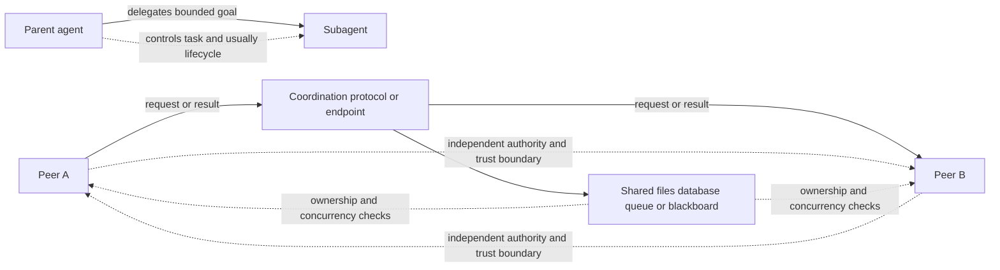

# Agent Ecosystem and Coordination

This page is a conceptual synthesis of the source notes. It describes the roles and
trade-offs they document; it does **not** mean that any named agent, protocol, model,
or integration is deployed by this repository.

## What “agent” means here

An **agent** is not a single product category with a universally agreed definition.
In the notes, it usually means an LLM in a loop: the model chooses an action, calls a
tool, observes the result, and repeats until the task is complete. Planning,
memory, tool use, and sometimes delegation to
[subagents](agent-systems.md) are recurring parts of that architecture. The important
distinction from a fixed workflow is that the model directs the next step rather than
hard-coded control flow. An [agent harness](agent-systems.md) provides the execution
loop and surrounding controls; a library or product may package that architecture
without being the architecture itself.

A **subagent** is a task-scoped delegate under a parent agent. The parent normally
assigns part of its goal and controls the task and, often, the delegate’s lifecycle.
A subagent can therefore be implemented using much of the same machinery as a peer—an
endpoint, a tool call, or an asynchronous job—without becoming an independent peer.

A **peer agent** is independently governed: it owns goals and authority, can initiate
or reject work, and can continue operating without a permanent parent. The relationship
is task-scoped: two system-level peers can temporarily delegate a bounded task to one
another, but neither has standing authority to override or terminate the other.
Peerhood comes from independent goal and authority ownership, not from a transport or
message format.

## Coordination and authority boundaries

The following flow separates local delegation from peer coordination. A mediator may
route messages, but routing does not give it authority over either peer. The trust
boundary is consequently explicit: identity, authorization, task ancestry, and
concurrent writes must be checked at each agent or shared-state boundary rather than
assumed from the protocol.

*The diagram contrasts parent-controlled delegation with mediated communication between independently governed peers.*

Peer implementations may communicate synchronously or asynchronously, or coordinate
indirectly through files, databases, repositories, queues, or blackboards. Those
choices introduce distributed-systems concerns that ordinary delegation can hide:
authenticated identities, task and ancestry IDs, idempotency, concurrency control,
distributed termination, and cycle detection. Failures or compromise can propagate
through inter-agent communication, so approval policies, credentials, budgets, and
other authority must remain bounded at the trust boundary.

## Protocol roles

### Agent2Agent (A2A)

[A2A](https://a2a-protocol.org) is described in the notes as a Google-designed protocol
for communication and interoperability between opaque agentic applications—a “REST API
for agents.” Its data model distinguishes messages from stateful tasks and also covers
remote-agent discovery, status updates, and artifacts. That makes it suitable for
cross-agent collaboration where the remote implementation is not exposed as a local
tool. The notes qualify its adoption: at the time written, it had not gained broad
traction on the open internet and was emerging mainly inside enterprise platforms.

A2A does **not** establish peerhood. It can carry an interaction between peers, but it
can also transport a parent’s delegated task; authority still belongs to the agents’
ownership and policies. The distinction between agents and tools in the source notes is
also operational: agents can handle imprecise, text-formulated requests and participate
as peers in problem solving, while tools are better for specific, well-defined tasks.

### Agent Client Protocol (ACP)

[ACP](https://agentclientprotocol.com/) standardizes communication between code editors
or IDEs and coding agents. In the source notes it is specifically characterized as an
IDE-oriented protocol, not a general replacement for agent-to-agent coordination. It
therefore describes a client boundary—editor to coding agent—rather than independent
peer authority between remote agents.

## Concrete coding agents and agent packages

The notes distinguish these products by execution surface, governance, model coupling,
and persistence—not by claiming that they all implement the same protocol:

| Agent or package | Operational characteristic in the notes | Role in the ecosystem |
|---|---|---|
| **Antigravity** | Google’s agent-first development platform built on Gemini; its IDE, desktop app, and CLI share an agent harness that operates across editor, terminal, and browser. | A multi-surface product and harness, not merely a model name. |
| **Claude Code** | Anthropic’s terminal-native coding harness running Claude, with file, shell, and code tools; it is available through CLI, IDE extension, and SDK. Usage can be traced with the documented LangSmith plugin. | A vendor-specific coding agent and harness. |
| **Codex** | OpenAI’s open-source terminal CLI plus cloud environments and IDE integration, powered by OpenAI coding models; tasks can run end-to-end with agents working in parallel across Git worktrees. | A coding agent with local and cloud execution surfaces. |
| **Deep Agents** | An opinionated LangChain library packaging planning, subagents, durable memory, human-in-the-loop, and workflows on LangGraph. | A reusable agent-pattern package whose harness is LangGraph, rather than an independent cloud engineer. |
| **Devin** | Cognition’s cloud-based autonomous software engineer, planning and executing coding tasks end-to-end and asynchronously in an isolated sandbox. | A delegated cloud agent, closer to an asynchronously assigned engineer than a local pair-programmer. |
| **OpenCode** | An open-source, terminal-native, model-agnostic agent from the SST team; it runs locally and stores sessions on disk, connecting to many model providers. | A vendor-neutral counterpart to Claude Code; the notes say it can use Codex or Antigravity subscriptions but not Claude. Usage can be traced with the documented LangSmith plugin. |

These descriptions should not be collapsed into a single “agent runtime” category. A
harness is the control surface that runs an agent loop; a package such as Deep Agents
supplies patterns for building one; a coding product such as Devin or Claude Code
bundles an agent with an operational interface; and a peer is a governance and
coordination relationship. The same underlying agent machinery can appear in several
of these roles, but the authority boundary changes the safe design and failure model.

## Practical selection and safety questions

When integrating one of these systems, first identify the boundary being integrated:
editor-to-agent (ACP), agent-to-agent (potentially A2A), local tool or subagent call,
or an independently governed peer. Then establish who owns the goal, what credentials
and writes are authorized, how task identity and retries are represented, and where
human approval is required. For asynchronous or multi-agent work, also define
idempotency, shared-state ownership, termination, and cycle handling before treating a
successful message exchange as a successful task.

The source notes provide product references and protocol links for further reading, but
make no claim that these systems are configured, deployed, or interoperating here.
