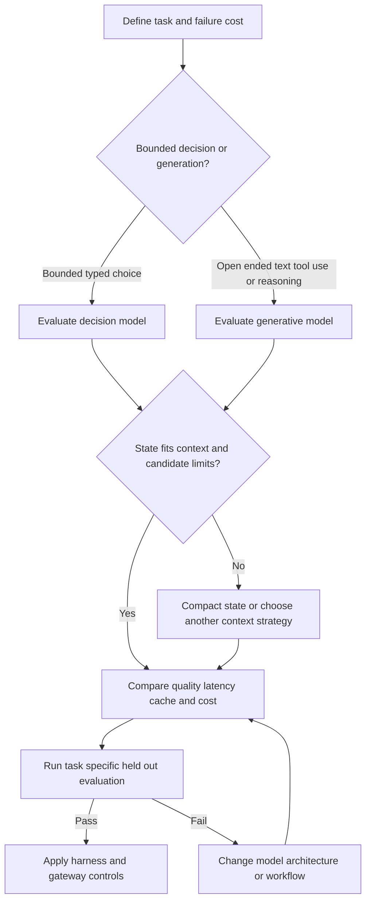

# Model Architecture and Selection

Model choice is a systems decision, not a leaderboard lookup. The useful question is
which model and serving arrangement meets a task's quality, latency, context, cost,
and control requirements. Keep three layers separate:

1. **Model capability and architecture** — what the weights can represent and how
   much computation and cache memory a request requires.
2. **Decision policy** — whether a model generates candidates and reasoning or makes
   a bounded typed judgment over supplied choices.
3. **Integration controls** — the [agent system](../architecture/agent-systems.md),
   provider API, gateway, quotas, prompt caching, routing, and escalation policy
   that decide how the model is used.

Provider prices and public benchmark positions are time-sensitive source-note
observations, not universal guarantees. The provider notes here were verified on
2026-07-11, the leaderboard note is dated 2026-07-13, and the architecture note is
dated 2026-10-03; recheck the linked documentation before making a purchase or
capacity decision.

## Selection flow

Start with the workload contract, then test candidates under the same harness and
cost assumptions. A provider switch does not by itself change tool permissions,
fallback rules, or approval gates.

*This flow separates model selection from workload preparation, validation, and integration policy.*

## Architecture that changes serving behavior

Most contemporary open-weight LLMs remain decoder-only Transformers: token
embeddings, attention and feed-forward blocks, residual connections, and
normalization. The important selection differences are generally efficiency and
multimodality choices layered onto that core, rather than entirely different model
categories.

### Sparsity: total parameters are not active compute

A Mixture-of-Experts (MoE) feed-forward block routes each token to only a subset of
many experts. **Total parameters** affect weight memory and potential capacity;
**active parameters per token** more directly affect per-token compute and latency.
Thus, a 235B MoE is not equivalent to a 235B dense model. Shared experts, expert
count, and routing layout also differ by family, so compare the serving footprint
rather than the headline parameter count alone.

### Attention and the KV cache

Autoregressive generation caches each layer's keys and values so the prefix is not
recomputed at every step. That improves generation speed, while cache memory grows
with context length, layers, and attention heads. A serving stack may additionally
reuse a common prefix across requests; provider prompt caching and vLLM prefix
caching are serving-level reuse, distinct from the per-sequence KV cache.

- **MHA** gives every query head its own key/value head and is the baseline.
- **GQA** shares key/value heads among query heads, reducing cached tensors.
- **MLA** compresses keys and values into a lower-dimensional latent before caching;
  it trades additional computation for a smaller cache.

Fewer layers or KV heads, smaller head dimensions, and local attention windows can
further reduce cache requirements. These are operational constraints: inspect
concurrency, context length, and cold/warm behavior rather than inferring cost from
parameter count.

### Local, linear, and global attention

Sliding-window attention bounds per-layer cache and compute, but a layer with a
window cannot directly see tokens outside that window. Interleaving local or linear
layers with global-attention layers preserves long-range access. Therefore a long
context limit is not the same as reliable long-context reasoning: measure the amount
of global access and test the actual retrieval or reasoning workload.

Normalization placement, width versus depth, positional encoding, optimizer,
multi-token prediction, and FlashAttention can affect training or implementation,
but the architecture note characterizes many of these as empirical choices rather
than universal selection rules. FlashAttention changes the implementation of
attention, not the model's attention semantics.

## Multimodality

Vision-language designs commonly begin with a pretrained modality encoder and differ
in where its representation enters the language model:

- **Unified embedding-decoder:** project image representations into the text
  embedding space and concatenate them with text tokens. This reuses decoder-only
  tooling, but image tokens consume context and the decoder must learn to interpret
  them.
- **Cross-modality attention:** keep text in the decoder's normal stream while
  cross-attention layers read encoder outputs. Image tokens do not fill the text
  context in the same way, and a frozen text decoder can preserve text-only
  behavior, at the cost of extra cross-modal components.

Hybrid designs exist. Choose based on image-token budget, text-only regression risk,
latency, and the multimodal tasks actually tested—not on the label “vision model.”

## Generative models versus decision models

A generative model proposes text, tool calls, or candidate solutions and is suited to
open-ended reasoning and synthesis. A **decision model** instead evaluates a state
against a bounded question and returns a typed result. Jev's documented primitives
are:

| Primitive | Use | Result |
| --- | --- | --- |
| Choice | Select among supplied options | Option, distribution, and confidence |
| Score | Place state on an ordered rubric | Score, distribution, and confidence |
| Noul | Test a proposition | Value from 0 to 1 |

Questions in a Jev request are evaluated independently against the same state. This
makes decomposition into atomic checks and code-level combination explicit. Typed
output prevents malformed free text, but does not prove correctness or calibration;
validate representative data and set escalation thresholds according to the cost of
mistakes. A closed choice set needs an explicit “none applies” fallback.

CLM is an open-source, separately trained alternative for this bounded System One
role. Its contrastive objective separately represents state and candidates, can reuse
embeddings, and scores supplied candidates rather than inventing an arbitrary new
action. The documented CLM-v0.1-8B serving path uses a frozen Qwen3-8B backbone,
projection heads, vLLM's pooling runner, and a `clm-serve` decision API. Its default
encoder context is 2,048 tokens, so long trajectory states require both serving-limit
changes and testing for truncation and candidate coverage. CLM is not evidence that
Jev has the same architecture or that Jev weights are publicly released.

Use a decision model for frequent, bounded routing or confidence gates; use a
generative model to propose candidates or perform extended reasoning. They are
complementary in an agent harness, not interchangeable merely because both expose an
API.

## Provider integration trade-offs

The provider notes describe pricing and caching mechanics for particular models and
dates. They should inform a cost model, not be treated as stable product contracts.

| Concern | Claude note | Gemini note | GPT note |
| --- | --- | --- | --- |
| Cache behavior | Explicit or automatic prefix caching; 5-minute default, optional 1-hour TTL; a successful hit refreshes the 5-minute TTL | Implicit caching is opportunistic; explicit named caches have a default 1-hour TTL and storage charges | Automatic or explicit breakpoints; stable `prompt_cache_key` improves matching and cached prefixes are eligible for at least 30 minutes |
| Long-context cost | The cited 1M-context models use the listed rates throughout the window | The cited Pro preview has separate full-request rates up to and over 200K input tokens | The cited GPT-5.6 Sol switches the entire request above 272K input tokens to higher rates |
| Operational implication | Put stable content first and inspect cache creation/read usage | Use implicit caching for convenience, explicit caches when identity and reuse are predictable; count tokens | Log ordinary, cached, and write tokens; compact before the pricing cliff and treat keep-alives as experiments |

Cache hits, writes, storage, and token-per-minute accounting differ by provider.
Inputs, generated output, and thinking tokens also interact with later turns: output
becomes input when retained in conversation history. A gateway should normalize these
measurements and enforce budgets, but it cannot make provider semantics identical.

## Evidence and evaluation

Use public sources for discovery, then verify. The leaderboard note explicitly says
no single source is simultaneously comprehensive, current, independent,
methodologically consistent, and broad across coding, tools, reasoning, knowledge,
long context, and real workflows. A practical map is:

| Capability | Primary signal | Required local check |
| --- | --- | --- |
| Repository software engineering | SWE-Bench Pro | Representative repositories and patch tests |
| Function calling | BFCL | The deployment's own schemas and validation errors |
| Multi-step tools | τ²-bench | Full workflow with retries, permissions, and side effects |
| Long context | AA Long Context Reasoning | Application-specific retrieval and truncation tests |
| Conversation | Arena category scores | Blind review against the actual user task |
| Cost efficiency | Cost per successful task | Provider usage, cache, latency, and failure logs |

Benchmark scores measure outcomes under their harnesses. They do not establish that
the same model will perform identically with different prompts, tools, context
packing, sampling, or gateway routing. For decision models, separately test accuracy,
probability calibration, candidate-set coverage, and cold/warm latency. For all
models, compare quality per successful task, tail latency, context behavior, and
failure recovery—not only tokens per second or list price.

## Boundary: model, harness, and gateway

Model selection chooses weights or a hosted model and its compatible modality,
context, and inference profile. The harness owns the workflow: state construction,
tool selection, retries, candidate generation, validation, approval, and fallback.
The gateway owns integration policy such as provider routing, quotas, spend caps,
credential isolation, logging, and provider-specific request shaping. Prompt caching
is a provider/gateway optimization; it does not change the model's knowledge or
make a stale state safe.

A safe rollout therefore pins the model and provider configuration, runs held-out
workflow evaluations, records ordinary/cache-read/cache-write usage, tests long and
short contexts, and keeps an explicit fallback or human escalation path. Treat
external provider URLs and leaderboard links as references from the dated notes, and
revalidate them before relying on current prices, availability, or rankings.

## References

- [LLM architecture notes](https://magazine.sebastianraschka.com/p/the-big-llm-architecture-comparison)
- [Multimodal architecture notes](https://magazine.sebastianraschka.com/p/understanding-multimodal-llms)
- [Claude pricing and caching](https://docs.anthropic.com/en/docs/about-claude/pricing)
- [Gemini pricing and caching](https://ai.google.dev/gemini-api/docs/pricing)
- [GPT pricing and caching](https://developers.openai.com/api/docs/pricing)
- [Leaderboard map](https://artificialanalysis.ai/)
