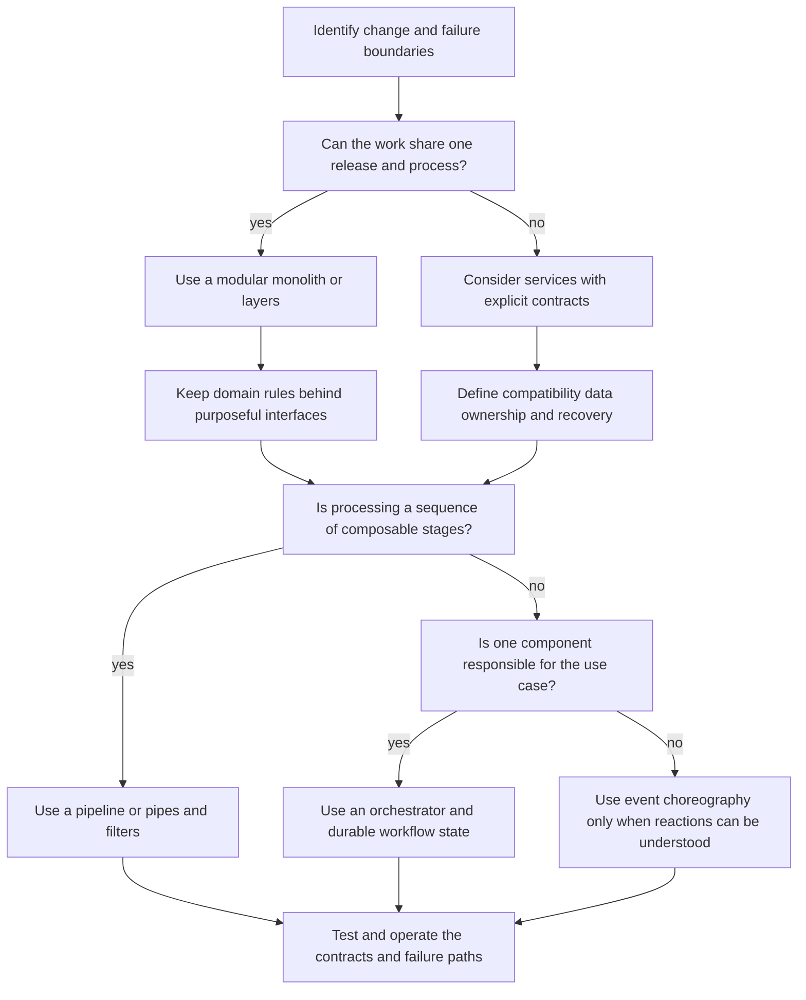
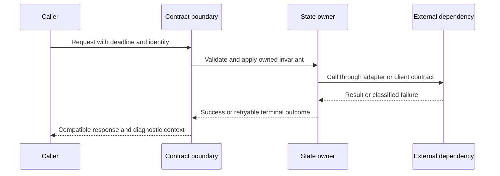

# Software Architecture and Development Practice

Architecture is the set of boundaries that determines what changes together, what
communicates across a contract, and where failures are contained. Development
practice is the discipline of keeping those boundaries understandable as the system
and its requirements change. This page is a decision guide, not a ranking of
patterns: a system may combine several patterns, and a boundary inside one process
has different costs from a network and deployment boundary.

<!-- openwiki: broken internal link [architecture/architectural-patterns.md] file "architecture/architectural-patterns.md" does not exist. Fix the href or restore the target, then delete this comment. -->
The companion [architectural patterns](architecture/architectural-patterns.md) note
is the reference for the pattern families and source readings. This page turns
those notes into a repeatable design and change process. The [distributed systems
reading map](distributed-systems/distributed-systems.md) supplies the mechanisms
<!-- openwiki: broken internal link [reliability/simplicity.md] file "reliability/simplicity.md" does not exist. Fix the href or restore the target, then delete this comment. -->
behind consistency, replication, and failure choices; [SRE and simplicity](reliability/simplicity.md)
connects those choices to operation and maintenance.

## Start with the boundary, not the pattern name

Ask these questions before choosing a structure:

1. **What belongs together?** Group work with high cohesion and shared invariants.
   Separate work that has different change rates, ownership, scaling needs, or
   failure-containment requirements.
2. **Where does it run?** A module or modular monolith avoids a network hop and
   remote partial failure. A service adds independent release and scaling options,
   but also requires explicit data ownership, compatibility, observability, and
   recovery.
3. **What must be true atomically?** Name the invariant and its owning write path.
   Decide which reads may be stale and what happens when a multi-component action
   completes only partially.
4. **What is the contract?** Specify inputs, outputs, errors, ordering, timeouts,
   idempotency, and compatibility. Prefer an application-shaped port over exposing
   a vendor or transport API directly.
5. **Which failure must be contained?** Locate retries, deadlines, circuit breaking,
   backpressure, replay, compensation, and operator intervention. A boundary that
   cannot be observed or recovered is not yet a useful operational boundary.

These questions preserve the central trade-off: cohesion reduces coordination inside
a boundary, while decoupling protects independent change. Domain knowledge, team
ownership, consistency requirements, latency, and operational capability determine
the balance; there is no universally best topology.

## A practical selection map

*This map frames questions; it does not prescribe a single architecture.*

### Pattern choices and the question each choice creates

| Structure | Prefer it when | Make the following explicit |
| --- | --- | --- |
| **Modular monolith** | Clear domain ownership is needed but one deployment is sufficient | Module contracts, dependency direction, and whether cross-module changes are becoming routine |
| **Layers** | Application workflows, domain rules, and infrastructure have distinct responsibilities | The responsibility of each layer; avoid layers that only forward calls |
| **Services** | Independent release, scaling, or operational isolation is worth distribution | Remote failure, data ownership, compatibility, latency, deployment, and on-call cost |
| **Ports and adapters** | Core behavior should be testable independently of protocols, storage, or vendors | Application-shaped interfaces and which adapters translate external concerns |
| **Pipeline / pipes and filters** | Processing is a composition of stages | Message shape, ordering, backpressure, retry/replay, and stage-level failure recovery |
| **Proxy / gateway** | Routing, protocol translation, or shared policy belongs at a common entry point | Availability, trust boundaries, policy ownership, and the gateway's added latency and blast radius |
| **Orchestrator** | A use case coordinates several components and its sequence should be visible | Workflow state, timeout and retry policy, compensation, and partial completion |
| **Plugins** | A stable core needs replaceable extensions | Extension lifecycle, compatibility, supported combinations, and isolation of faulty extensions |

The table combines patterns rather than treating them as mutually exclusive. For
example, a service may use ports and adapters internally, a gateway may expose a
pipeline of policies, and an orchestrator may call several services. Reconsider a
pattern when its boundary is routinely bypassed, its contract cannot be versioned,
or its operational cost exceeds the independence it buys.

## Communication and ownership

Choose communication based on where coupling should live:

- **Orchestration** puts sequence and responsibility in a workflow owner. It makes
  a cross-component use case visible and changeable, but the owner must carry
  workflow state and recovery responsibility.
- **Choreography** lets components react to events. It can reduce direct knowledge
  between participants, but end-to-end behavior becomes harder to reconstruct and
  test as reactions accumulate.
- **Shared data** makes a common model convenient to access, while coupling
  consumers to schema evolution and often obscuring write ownership.

These styles can coexist. Record, for each important data item, who owns writes,
which operations are atomic, what stale reads are acceptable, and how retries avoid
duplicate side effects. An event or RPC is not a boundary by itself: the boundary
is the contract plus its compatibility and failure semantics.

*The sequence highlights the contract, state owner, and failure classification that a design must make observable.*

At a wire boundary, schema evolution is part of architecture. The repository's
Protocol Buffers note uses permanently assigned field numbers to support old and new
producers and consumers, while also noting that payloads are not self-describing and
therefore require schema distribution. The general lesson applies beyond protobuf:
make compatibility rules, ownership, and inspection tooling explicit rather than
assuming that serialization alone is a contract.

## Operability is part of the design

For every boundary, specify:

- **Admission:** authentication and authorization, validation, rate limits, and
  resource bounds.
- **Timing:** deadlines, queue limits, timeout ownership, and whether a retry is
  safe.
- **Failure:** transient versus permanent errors, retry budgets, idempotency keys,
  deduplication, compensation, and manual recovery.
- **Visibility:** structured logs with correlation context, metrics for saturation
  and outcomes, traces across calls, and a way to inspect contract versions and
  workflow state.
- **Change:** rollout order, backwards and forwards compatibility, migration and
  rollback strategy, and the smallest safe deployment unit.

Do not move a boundary merely to relocate complexity. A gateway can centralize
policy but becomes an availability and trust boundary; a service can scale
independently but turns local calls into remote coordination; a shared schema can
simplify access but makes evolution a joint responsibility. Measure latency,
resource use, error rates, and operator effort against the stated requirement.

## Incremental development and change

Use a narrow feedback loop:

1. State the behavior, invariant, and operational constraint that must change.
2. Draw the current request path and state owners; identify callers, adapters,
   persistence, and external dependencies before editing a boundary.
3. Make the smallest contract-preserving change. Keep compatibility shims or
   dual-read/dual-write migrations only for a defined transition, then remove
   them.
4. Test the new behavior at the lowest meaningful level, then test the contract,
   failure path, and representative end-to-end flow.
5. Release an observable slice, compare it with the expected SLO and failure
   budget, and retain a rollback or forward-fix path.
6. Delete obsolete code and update the decision record once the migration is
   complete.

Small, understandable changes reduce the set of plausible causes when a regression
appears. They also expose whether a proposed boundary actually supports independent
change: if every change requires synchronized edits everywhere, the interface is
probably not yet a decoupling boundary.

### Tests that matter at a boundary

Test behavior and contracts, not merely the existence of components:

- **Unit tests** for domain invariants and policy decisions without network,
  database, or vendor dependencies.
- **Adapter tests** for translation, serialization, timeout handling, and error
  classification against the real protocol or a compatibility fixture.
- **Contract tests** for request/response and event schemas, including old/new
  producer-consumer combinations, unknown fields, defaults, and rejected changes.
- **Workflow tests** for ordering, retries, idempotency, duplicate delivery,
  timeout, cancellation, compensation, and restart from persisted state.
- **Integration tests** for ownership and transaction boundaries, migration
  behavior, authentication, and representative dependency failures.
- **Operational tests** for saturation, alert signal quality, rollout/rollback,
  and recovery procedures; a happy-path test cannot establish operability.

The required depth follows the risk. A pure in-process module may need focused unit
and contract tests; a distributed workflow needs failure-injection and recovery
coverage because partial completion is part of its normal design space.

## Repository reading map

This page is general guidance rather than an audit of a particular implementation.
For repository-specific design work, use these notes together:

<!-- openwiki: broken internal link [architecture/architectural-patterns.md] file "architecture/architectural-patterns.md" does not exist. Fix the href or restore the target, then delete this comment. -->
- [Architectural patterns](architecture/architectural-patterns.md) for pattern
  trade-offs, communication styles, and primary-source qualifications.
<!-- openwiki: broken internal link [distributed-systems/distributed-systems.md] file "distributed-systems/distributed-systems.md" does not exist. Fix the href or restore the target, then delete this comment. -->
- [Distributed systems](distributed-systems/distributed-systems.md), then its
  notes on storage, replication, consistency, and consensus, for mechanism-level
  constraints.
<!-- openwiki: broken internal link [communication/protobuf.md] file "communication/protobuf.md" does not exist. Fix the href or restore the target, then delete this comment. -->
<!-- openwiki: broken internal link [communication/grpc.md] file "communication/grpc.md" does not exist. Fix the href or restore the target, then delete this comment. -->
- [Protocol Buffers](communication/protobuf.md) and [gRPC](communication/grpc.md)
  for schema and RPC boundary concerns.
<!-- openwiki: broken internal link [reliability/simplicity.md] file "reliability/simplicity.md" does not exist. Fix the href or restore the target, then delete this comment. -->
<!-- openwiki: broken internal link [reliability/sre.md] file "reliability/sre.md" does not exist. Fix the href or restore the target, then delete this comment. -->
- [Simplicity](reliability/simplicity.md) and [SRE](reliability/sre.md) for
  reliability, toil, SLO, and change-practice context.
<!-- openwiki: broken internal link [infrastructure/planes.md] file "infrastructure/planes.md" does not exist. Fix the href or restore the target, then delete this comment. -->
<!-- openwiki: broken internal link [infrastructure/service-mesh.md] file "infrastructure/service-mesh.md" does not exist. Fix the href or restore the target, then delete this comment. -->
- [Infrastructure planes](infrastructure/planes.md) and [service mesh](infrastructure/service-mesh.md)
  when deciding which communication policy belongs in applications versus
  infrastructure.

Treat classifications and historical system designs as models with assumptions.
Validate any performance or reliability claim against the actual call path,
workload, deployment, and measured operational behavior.
