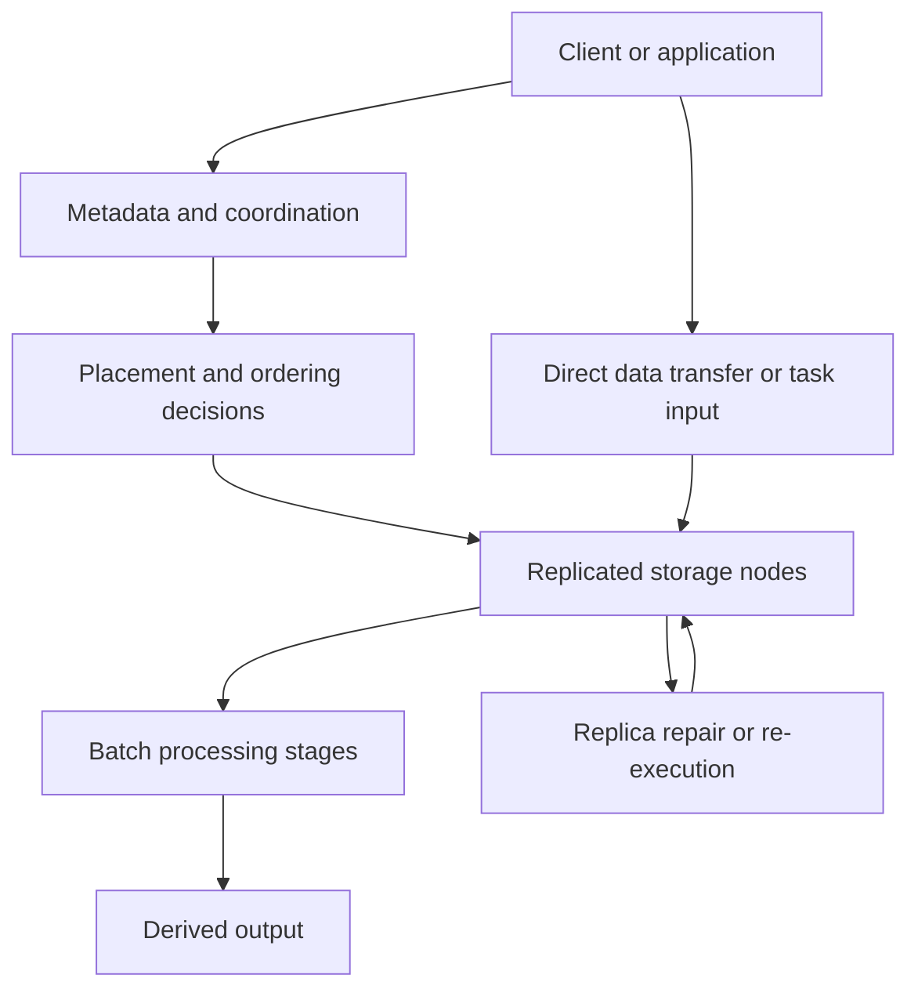
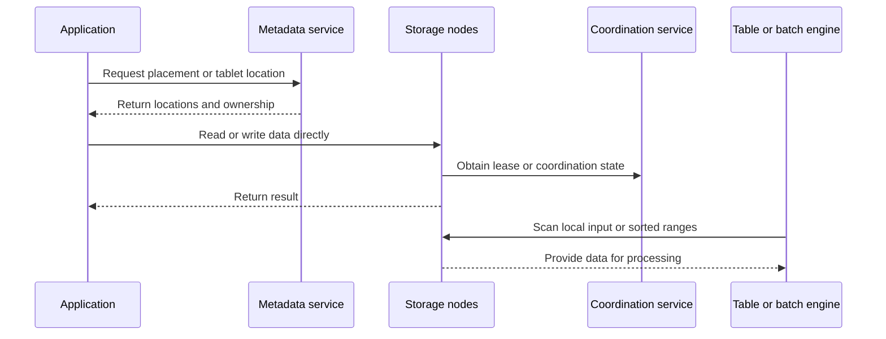
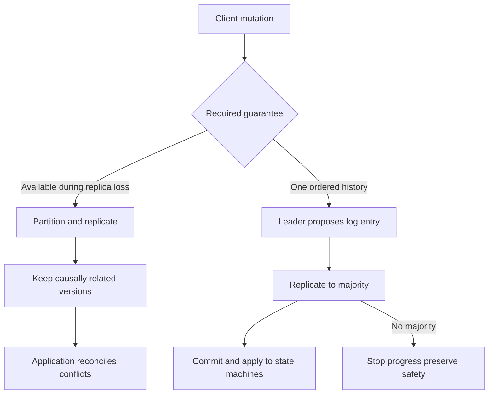

# Distributed Systems Foundations and Designs

> **Reference material, not a deployed-system description.** The designs below are historical papers and study notes. Their guarantees, measurements, and implementation details should not be treated as the behavior of a current managed product or as a production architecture prescription.

Distributed-systems design is largely the placement of responsibility under partial failure. A client may observe a timeout without knowing whether a server committed a request; replicas may diverge; clocks may disagree; and a worker may pause after producing output but before reporting completion. The central questions are therefore: what state is authoritative, who orders mutations, what can be retried safely, and which guarantees are worth the coordination cost?

## Suggested reading route

<!-- openwiki: broken internal link [designing_data_intensive_applications.md] file "designing_data_intensive_applications.md" does not exist. Fix the href or restore the target, then delete this comment. -->
1. **Build the vocabulary.** Read [Designing Data-Intensive Applications](designing_data_intensive_applications.md), beginning with chapters 8 and 9 on partial failure, clocks, consistency, and consensus. Add chapter 7 for transaction anomalies, then chapters 3, 5–6, and 10–11 for storage, replication, partitioning, batch, and stream processing.
<!-- openwiki: broken internal link [google_file_system.md] file "google_file_system.md" does not exist. Fix the href or restore the target, then delete this comment. -->
<!-- openwiki: broken internal link [bigtable.md] file "bigtable.md" does not exist. Fix the href or restore the target, then delete this comment. -->
2. **Start from the storage substrate.** Read [Google File System](google_file_system.md), then [Bigtable](bigtable.md). This pair shows how a metadata service, replicated chunks, sorted row ranges, and an LSM-like storage engine fit together.
<!-- openwiki: broken internal link [map_reduce.md] file "map_reduce.md" does not exist. Fix the href or restore the target, then delete this comment. -->
3. **Study processing over that substrate.** Read [MapReduce](map_reduce.md) for the map, shuffle, and reduce lifecycle, including locality, retries, and speculative backup tasks.
<!-- openwiki: broken internal link [dynamo.md] file "dynamo.md" does not exist. Fix the href or restore the target, then delete this comment. -->
<!-- openwiki: broken internal link [raft.md] file "raft.md" does not exist. Fix the href or restore the target, then delete this comment. -->
4. **Contrast replication choices.** Read [Dynamo](dynamo.md) for availability-first replication and application-visible conflicts; read [Raft](raft.md) for a majority-backed ordered log and state-machine safety.
<!-- openwiki: broken internal link [spanner.md] file "spanner.md" does not exist. Fix the href or restore the target, then delete this comment. -->
5. **Finish with cross-group transactions.** Read [Spanner](spanner.md) for synchronous replication, transaction coordination, bounded clock uncertainty, and externally consistent ordering.

The source notes preserve publication versions and primary-source links. In particular, the inspected DDIA copy is a 2016 early release rather than the finished first edition, and the Spanner note distinguishes the 2013 journal article from the earlier OSDI paper.

## A common model: data plane, control plane, and failure boundary

A useful comparison is to separate the path carrying data from the control path that places, orders, or repairs it. GFS clients obtain chunk locations from the master but transfer file data directly to chunkservers. Bigtable tablets use GFS for persistent storage and Chubby for coordination. MapReduce schedules work near input data, while its runtime tracks task completion and re-executes failed or slow work.

This diagram shows the recurring separation between control decisions, data movement, processing, and recovery; each paper implements the boundaries differently.

### The irreducible failure cases

- **Partial failure:** timeouts and process pauses make failure detection uncertain. A retry can duplicate a mutation unless the operation is idempotent or deduplicated.
- **Replica disagreement:** replication can preserve availability by accepting writes at reachable nodes, or preserve a single ordered history by requiring a quorum. The choice changes what reads and applications must do.
- **Loss of coordination:** a consensus group can stop committing without a communicating majority. This sacrifices availability rather than safety.
- **Slow work:** a healthy but straggling worker can dominate job completion, motivating speculative backup tasks; re-execution makes deterministic computation and side-effect control part of the contract.
- **Clock uncertainty:** physical time is not automatically a safe ordering mechanism. Spanner makes uncertainty explicit and pays commit-wait before exposing a commit order.

## Storage designs: layout is a correctness and operations decision

**GFS** uses a master for metadata and chunkservers for replicated file chunks. Clients ask the master for locations, then move data directly to chunkservers. Large chunks and append-heavy workloads suit large data processing and routine machine failures, but the design is not a general POSIX filesystem with identical consistency expectations in every operation. Leases coordinate mutation order; record append may leave duplicates, so applications must tolerate or remove them.

**Bigtable** makes the key schema part of the distribution strategy. Its sparse, sorted map is indexed by row, column, and timestamp; tablets partition contiguous row ranges, and operations on one row are atomic. Row-key choice determines locality, range-scan behavior, and the risk of hot spots. Memtables, SSTables, and compaction support the storage engine, while GFS supplies persistent storage and Chubby supplies coordination. This is a reminder that a logical table abstraction does not hide physical access patterns or operational cost.

This request and data-flow view highlights that metadata lookup and coordination need not carry the bulk data path.

## Processing: make retries part of the semantics

MapReduce gives the application a small model—map emits intermediate key/value pairs, shuffle groups values by key, and reduce processes each group—while the runtime owns partitioning, scheduling, communication, locality, and worker-failure recovery. Intermediate data is therefore a lifecycle with recomputation boundaries, not merely a function call. Backup tasks reduce the impact of stragglers.

The important boundary is side effects. A task may be re-executed after a worker failure or uncertain acknowledgement, so output publication and external effects must be deterministic, idempotent, isolated, or otherwise reconciled. GFS and MapReduce are consequently best read together: storage handles replicated chunks and append behavior, while the processing runtime decides when work is replayed and where to place it.

## Replication and consistency: two deliberate ends of a spectrum

**Dynamo** uses consistent hashing to partition and replicate keys. Vector clocks preserve causality among versions; concurrent versions can be returned to the application for reconciliation. Sloppy quorums and hinted handoff keep writes available when preferred replicas are temporarily unreachable, while Merkle trees support background repair. The benefit is availability and flexible failure handling; the cost is that the application must understand conflicts and the possibility that a successful write has not produced one immediately agreed value.

**Raft** instead organizes replicas as a replicated log. A leader orders entries; terms, voting restrictions, commitment rules, and state-machine application preserve a safe history. Progress requires a communicating majority, so losing the majority can stop writes even while committed state remains safe. Consensus orders commands, but it does not automatically eliminate duplicate client requests: client identity, request sequence, or state-machine deduplication remains an application protocol concern.

The diagram is a design comparison, not a claim that Dynamo and Raft are interchangeable products: they solve different agreement and failure objectives.

## Coordination and transactions: Spanner's explicit cost

Spanner combines synchronous replication through Paxos groups with transactions that may span groups. TrueTime exposes a bounded interval rather than pretending that a timestamp is exact. Commit-wait delays visibility until the uncertainty interval permits the required ordering, supporting external consistency. Snapshot reads and multiversion storage let some reads proceed independently of concurrent updates, but the guarantees depend on the system's stated clock and replication assumptions.

Spanner illustrates a broader rule: stronger cross-partition ordering requires coordination somewhere—through quorum agreement, transaction protocols, or waiting on time uncertainty. Comparing it with Dynamo clarifies that “stronger consistency” is not free, and comparing it with Raft clarifies that consensus over a log is a building block, not by itself a distributed transaction protocol.

## Design checklist

When adapting these ideas, state the following explicitly:

- **Authority and placement:** Which service owns metadata, partition ownership, or the ordered log? How are hot keys and range locality handled?
- **Guarantee:** Is the requirement availability, per-row atomicity, linearizable ordering, causal reconciliation, snapshot isolation, or external consistency? Define what a successful write and a retry mean.
- **Failure behavior:** What happens on timeout, replica loss, leader loss, clock uncertainty, straggler, or lost majority? Which failures stop progress and which trigger repair or replay?
- **State and repair:** Where do versions, leases, logs, hints, SSTables, intermediate output, and deduplication records live? How is stale or conflicting state repaired?
- **Application obligations:** Can an append duplicate, can a task run twice, and can a client receive an acknowledgement twice? Make side effects idempotent or provide reconciliation.
- **Operational evidence:** Test the actual assumptions—partition behavior, failover, replay, compaction, repair, clock bounds, and recovery—not just the happy-path API.

## Primary reading links

<!-- openwiki: broken internal link [designing_data_intensive_applications.md] file "designing_data_intensive_applications.md" does not exist. Fix the href or restore the target, then delete this comment. -->
- [Designing Data-Intensive Applications notes and author site](designing_data_intensive_applications.md)
- [The Google File System paper](https://storage.googleapis.com/gweb-research2023-media/pubtools/4446.pdf)
- [MapReduce paper](https://storage.googleapis.com/gweb-research2023-media/pubtools/4449.pdf)
- [Bigtable paper](https://storage.googleapis.com/gweb-research2023-media/pubtools/4443.pdf)
- [Dynamo paper](https://www.allthingsdistributed.com/files/amazon-dynamo-sosp2007.pdf)
- [Raft extended paper](https://raft.github.io/raft.pdf)
- [Spanner journal article](https://research.google/pubs/spanner-googles-globally-distributed-database/)

<!-- openwiki: broken internal link [distributed-systems.md] file "distributed-systems.md" does not exist. Fix the href or restore the target, then delete this comment. -->
Related reading: [distributed-systems reading map](distributed-systems.md), [architecture and development](../architecture-and-development.md), and [reliability and learning](../reliability-and-learning.md).
