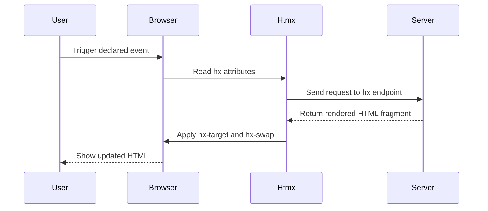

# HTMX and Server-Rendered Interactivity

htmx is a small, dependency-free JavaScript library for adding interactions to ordinary HTML. An element declares the request it can make, the event that triggers it, the destination for the response, and how the response is inserted. The server remains responsible for rendering the resulting HTML. This page documents the approach; it does not imply that this repository uses htmx.

## Request and response flow

The normal interaction is a server round trip that returns an HTML fragment rather than a client-side data object:



*The sequence shows the htmx runtime boundary: an event becomes an HTTP request, and the server-rendered fragment becomes DOM content.*

For example, a search field can request `/search` after a changed keystroke and place the returned list items into `#results`:

```html
<script src="https://cdn.jsdelivr.net/npm/htmx.org@2.0.11/dist/htmx.min.js"></script>

<input name="q" hx-get="/search" hx-trigger="keyup changed delay:300ms"
       hx-target="#results">
<ul id="results"></ul>
```

The `/search` endpoint should answer with an HTML fragment such as `<li>…</li>`, not JSON. The endpoint and its template therefore form a UI contract with the element that consumes the response: the fragment must be suitable for the selected target and swap mode.

## Attribute-driven interaction

The key attributes separate four decisions that plain HTML normally constrains to links and forms:

| Attribute | Responsibility | Examples |
| --- | --- | --- |
| `hx-get`, `hx-post`, `hx-put`, `hx-patch`, `hx-delete` | HTTP request to send | `hx-get="/search"` |
| `hx-trigger` | Event or schedule that sends it | `keyup changed delay:300ms`, `revealed`, `every 2s` |
| `hx-target` | Element that receives the response | CSS selector such as `#results` |
| `hx-swap` | How the response is inserted | `innerHTML`, `outerHTML`, `beforeend` |

This lets elements beyond `<a>` and `<form>` initiate requests, supports more than click and submit, and updates part of a page instead of replacing the whole document. The declarations remain close to the markup they affect, which makes the interaction visible in the server-rendered view.

## Hypermedia model and backend contract

In the hypermedia model, the server renders HTML and owns application state; the browser displays the representation it receives. A backend that renders templates can participate—for example, FastAPI or Django with Jinja templates. There is no required client-side model, JSON API, or frontend build step for the htmx interaction itself.

The backend contract is consequently HTML-shaped:

- An `hx-*` endpoint returns a fragment intended for a particular page location and swap behavior.
- Templates, not a JSON schema, define the structure the browser consumes.
- The server decides the state represented by the next fragment; the browser applies that representation to the target.
- Fragment endpoints are coupled to the page structure. Changing the target markup, the response fragment, or the swap mode can require coordinated changes.

This is distinct from a single-page application (SPA), where the server commonly exposes a JSON API and React or Vue renders the UI. htmx can coexist with small client-side behavior, but it is not a replacement for a client-owned state model when the product requires one. WebSockets, Server-Sent Events, and CSS transitions can also be expressed through attributes, extending the same declarative boundary without changing the central server-rendered model.

## Where it fits

**Good fits** include CRUD applications, admin panels, internal tools, dashboards, forms, search-as-you-type, infinite scroll, and polling status pages. These are mostly server-rendered applications that need targeted interactivity without maintaining a second JavaScript application and its build chain.

**Poor fits** include editors, canvases, heavy drag-and-drop, and other interfaces with rich client-side state or offline requirements. A product that already needs a JSON API for mobile or third-party clients may also have to maintain HTML endpoints as a second interface, reducing the benefit of choosing htmx.

A small script layer such as Alpine.js can complement htmx for local client-side behavior without introducing a full frontend framework. Conversely, use a frontend framework when the client must own substantial state, work offline, or coordinate complex interactions without a round trip for every change.

## Operational and lifecycle considerations

Every htmx interaction normally involves a server round trip, so network latency is part of the user experience and should influence trigger choices. Delays such as `delay:300ms`, targeted updates, and polling intervals are interaction policy, not merely markup decoration: they control request frequency and the freshness of displayed state.

The browser-side setup can be as small as loading the versioned script from the CDN shown above. The source note identifies htmx 2.0.x as the stable line, says that 2.x dropped IE support, and says the 1.x line is retained for IE. It also records that htmx 4.0 is released but not yet marked `latest` on npm, with a planned 2027 timeline; verify current release status before selecting a production version.

## Resources

- [Documentation](https://htmx.org/docs/)
- [Attribute reference](https://htmx.org/reference/)
- [Examples](https://htmx.org/examples/) — common UI patterns implemented with htmx
- [Essays](https://htmx.org/essays/) — the hypermedia rationale, including when *not* to use it
- [Hypermedia Systems](https://hypermedia.systems/) — the authors' book on the approach
