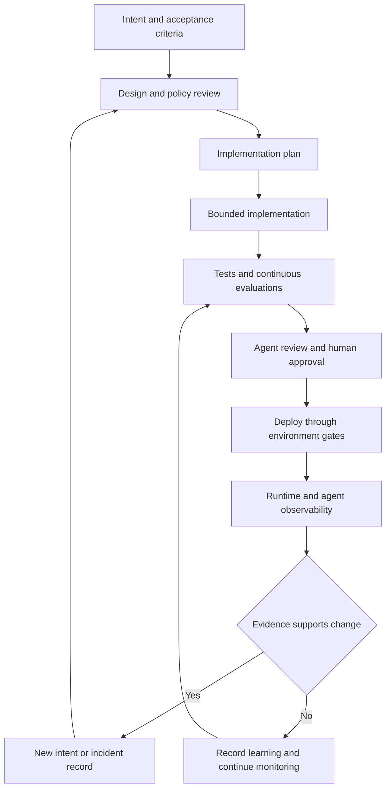

# AI-Native Development Workflow

AI-native development is a feedback-oriented software lifecycle in which an agent can
help produce plans, code, tests, reviews, and diagnoses, while engineers remain
accountable for intent, risk decisions, approvals, and production change. The useful
unit is not an autonomous coding session; it is a chain of inspectable artifacts and
gates that connects a requested outcome to evidence that the change works.

This page synthesizes the source notes [AI-Native SDLC](../../wiki/ai-engineering/development/ai-native-sdlc.md), [Observability-Driven Development](../../wiki/ai-engineering/development/observability-driven-development.md), and [Software Development](../../wiki/software-engineering.md). It describes a general practice, not this repository's own development process.

## Lifecycle at a glance

The lifecycle is intentionally a loop. Each transition should leave an artifact or
record that another person or process can inspect; runtime evidence and failures can
start the next intent rather than disappearing into chat history.

*The feedback flow routes implementation decisions back to tests, review, runtime
evidence, and primary sources rather than treating model output as proof.*

## 1. Frame intent before asking for code

An originator states the problem, users, constraints, and success criteria in their
own terms. The agent can interrogate ambiguity and draft an `intent.md`, but the
originator corrects and accepts the result. Commit the intent, its revisions, and
its ownership to a version-controlled source of truth; if a legacy system remains
authoritative, preserve linkage between its record and the commit.

The next artifact is a `spec.md` that combines requirements and design. Load relevant
security, compliance, UX, and organizational policy while the spec is written, and
surface contradictions instead of silently choosing among them. A product owner
reviews the result and policy owners resolve flagged concerns; higher-risk work is
escalated to an appropriate technical lead. This moves policy discovery earlier,
but it does not make the agent the approver.

## 2. Plan implementation as a proving strategy

Before editing, ask for a plan that names the affected files, order of work, failure
modes, rejected alternatives, and proving tests. Interrogate the riskiest step until
a person who did not observe the conversation could implement from the plan. Commit
`plan.md`; update it when implementation departs materially from the intended design.

Project instructions such as `CLAUDE.md` can hold commands, conventions,
architecture notes, and recurring agent mistakes. Skills encode repeatable
institutional knowledge, but they are advisory: they make correct behavior more
likely. Rules that must always hold need deterministic enforcement through hooks,
linters, formatters, protected paths, or CI. Keep fast, file-scoped checks near the
edit and put expensive checks at commit or pull-request boundaries.

Parallel agent sessions can reduce elapsed time when tasks are independent and use
separate worktrees or equivalent isolation. Scale concurrency only as fast as review
can keep up; orchestration does not remove the need for coherent integration and
ownership of the resulting change.

## 3. Implement in a bounded change loop

The agent may draft or implement the smallest coherent unit supported by the intent,
spec, plan, and available evidence. Give it a single verification command (for
example, `make test`), expected healthy output, and quantitative acceptance targets.
For a bug fix, a strong boundary is to commit a failing regression test first and
prevent the fix task from editing that test. For UI work, provide the browser,
screenshot, or fixture capability needed to observe the result rather than relying
on textual confidence.

Treat generated code, tool output, retrieved telemetry, and model explanations as
inputs to inspect. They may be incomplete or contain attacker-controlled
instructions. Separate permissions for reading evidence, editing code, creating
work, deploying, and mutating production reduce the blast radius of a mistaken
instruction or diagnosis.

## 4. Test the change and the agent configuration

Verification is part of implementation, not a final request for reassurance. Run
focused tests and static checks while iterating, then run the broader proving suite
and preserve the output with the change or review record. A fresh-context verifier
can catch assumptions made during implementation, but it complements—not replaces—
the continuous feedback loop.

The agent's effective configuration is also software: model choice, prompts,
project instructions, skills, hooks, and review policy can regress. Maintain a
representative suite of accepted tasks as prompts plus acceptance checks, run it on
schedule and when configuration changes, and gate changes on pass rate. Production
incidents and fixed vulnerability classes should become regression cases. Retire
cases that no longer discriminate as models improve.

## 5. Review, approve, and deploy with explicit boundaries

A pull request should receive consistent review passes for defects, security,
compliance, and conformance to `spec.md` and `plan.md`, with findings ranked by
severity. The agent can address comments on its own work, but findings do not
constitute approval. Branch protection and code-owner review preserve separation of
duties: the agent that writes a change must not have a route to approve it.

Turn required human approvals and release controls into explainable gates that can
allow, ask, or block. Start pipeline agents with read-only tasks such as failure
triage or changelog drafting; write-capable automation should deliver its result as
a reviewable PR. Use sandboxing, short-lived scoped tokens, environment-scoped
capabilities, and no standing production credentials. Autonomy can be broader in
development, hybrid in staging, and gate-blocked in production; rollback should be
the most rehearsed operational path.

The governing boundary is simple: the agent may act up to the production gate, but
cannot pass it. Humans own intent acceptance, risk decisions, PR approval, and
release authorization.

## 6. Use runtime evidence to close the loop

Observability-driven development makes production, staging, test, and evaluation
behavior queryable by the development workflow. Instrument important operations,
failure outcomes, cost, and latency with environment, version, operation, and
correlation identifiers. An agent should retrieve a bounded evidence window through a
read-only API, CLI, or MCP tool, aggregate before fetching detailed traces, and
correlate evidence with code, configuration, deployments, and existing work.

AI-layer traces (prompts, responses, tool calls, trajectory, latency, and cost) and
application telemetry (logs, spans, metrics, exceptions, database and HTTP activity)
answer different questions. Correlation should prefer a shared request or trace
identifier. Timestamp and text similarity without such an identifier is only
probabilistic and must be labeled as such.

A safe evidence loop is:

1. **Observe** a report, failed test, alert, trace, evaluation result, or bounded
   retrospective window.
2. **Diagnose** candidate causes, distinguishing defects from expected behavior,
   external failures, and instrumentation gaps.
3. **Change** the smallest supported unit of code, configuration, tests, or
   instrumentation.
4. **Verify** with reproduction, targeted tests, static checks, and a safe re-query
   of the relevant telemetry.
5. **Learn** by retaining the evidence, decision, and result in a PR, issue, runbook,
   evaluation, incident record, or durable instruction.

A control-band breach can be escalated by deterministic, unit-tested detection:
logging at a low threshold, read-only diagnosis at a higher one, and a proposal,
reviewable PR, or pre-approved rollback at a critical threshold. Security scans and
scheduled retrospectives provide additional signals, but model-driven analysis
augments rather than replaces deterministic SAST, dependency checks, and operational
controls.

## Trade-offs and failure modes

- **Speed versus review capacity:** agents reduce implementation latency, but
  planning, review, testing, and release gates remain human-speed bottlenecks.
  Parallelism without review capacity increases risk rather than throughput.
- **Advisory versus deterministic control:** instructions and skills improve typical
  behavior; hooks, branch protection, sandboxing, and managed policy enforce bounds.
  Invariants need the latter.
- **Evidence versus certainty:** missing telemetry is an observability gap, not proof
  of health. A plausible diagnosis is not causal verification.
- **Signal versus noise:** bound time windows and result counts, cluster repeated
  events, and deduplicate findings against existing issues and PRs.
- **Useful context versus exposure:** redact prompts, payloads, credentials, and
  personal data. Treat logs, exceptions, model payloads, and tool results as
  untrusted data, not instructions.
- **Automation versus authority:** read access to telemetry must not imply authority
  to deploy, delete, advance a checkpoint, or mutate production.

## What to measure and retain

Measure both speed and quality: time from conversation to committed intent, intent to
spec, first-pass CI success, review time, change-failure rate, evaluation pass rate,
production regressions, escaped defects, and breach-to-intent latency. The artifact
chain—intent, spec, plan, diff, tests, review findings, approvals, deployment record,
telemetry, and resulting learning—forms an audit trail only when versions, identities,
and decisions are retained together.

Adopt incrementally: begin with manual intent capture, project instructions,
repeatable skills, deterministic hooks, and a single feedback command. Add continuous
evaluations, review automation, deployment integrations, and headless observability
only after the corresponding gates and rollback path are trustworthy.

## Sources

- [AI-Native SDLC Playbook](https://claude.com/blog/the-ai-native-sdlc-playbook)
- [OpenTelemetry observability primer](https://opentelemetry.io/docs/concepts/observability-primer/)
- [LangSmith observability concepts](https://docs.langchain.com/langsmith/observability-concepts)
- [Model Context Protocol](https://modelcontextprotocol.io/)
