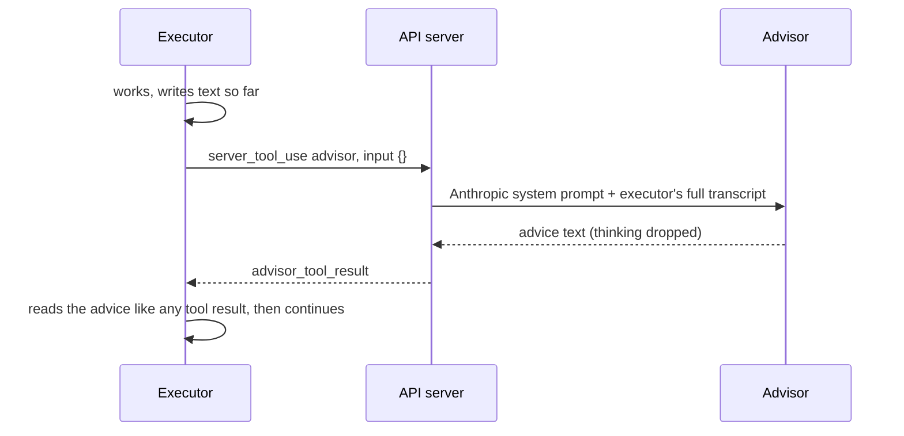

The advisor pattern pairs two models in one agent loop. A faster, cheaper **executor** does the work and, when it
decides to, consults a stronger **advisor** for strategic guidance. Most turns of a long agentic task are mechanical;
the advisor is paid for only where a good plan matters.[^advisor-api]

# How it works

- **A server-side tool.** The executor calls the tool `advisor` (type `advisor_20260301`, beta header
  `advisor-tool-2026-03-01`) like any other tool. Anthropic runs the advisor inference on its side, inside the same
  `/v1/messages` request, with no extra round trip for the client.[^advisor-api]
- **No question parameter.** The call's input is empty. "The server constructs the advisor's view from the full
  transcript automatically. Nothing the executor puts in `input` reaches the advisor."[^advisor-api]
- **The executor pauses.** The advisor's answer does not stream; the executor's stream pauses and the full result
  arrives in one event.[^advisor-api]
- **Text only back.** The advisor runs without tools, and its thinking is dropped. Only the advice text reaches the
  executor. Some advisor models return it encrypted to the client, but the executor still sees the
  plaintext.[^advisor-api]
- **Failures are soft.** An advisor error (rate limit, overload, `max_uses` exceeded) comes back as an error result,
  and the executor continues without advice.[^advisor-api]

# What the advisor sees

The advisor gets its own system prompt from Anthropic and "the executor's full transcript as quoted context": your
system prompt, the tool definitions, earlier turns and tool results, and what the executor has written so far in
this turn.[^advisor-api] So the advisor judges the actual state of the task, not the executor's summary of it. This
is the main difference from asking a [subagent](/ai-engineering/multi-agent/subagents.md), which starts cold and
sees only the prompt it is given.

# How the two communicate

One advisor call is one round of one-way advice. Control never leaves the executor.

- **No question, but an implied one.** The advisor reads the text the executor wrote in this turn, so the
  executor's last reasoning before the call ("the tests still fail after two fixes; next I plan to…") works as the
  question. This is our own reading of the docs; they don't describe it as a technique.[^advisor-api]
- **What comes back.** Plain advice: a plan, a correction, a warning. It is guidance, not tool calls or a
  result. The advisor's system prompt is not published.
- **Not a turn of its own.** The advisor is a single inference without tools. It can't read files, run tests or
  hand control back with work done. The executor decides whether to follow the advice.[^advisor-api]
- **Several calls.** The executor may call again later in the same task, up to `max_uses` per turn.[^advisor-api]

# Controls and cost

| Control | Effect |
| --- | --- |
| `model` | The advisor; it must be at least as capable as the executor[^advisor-api] |
| `max_uses` | Cap on advisor calls per turn (default unlimited)[^advisor-api] |
| `max_tokens` | Cap on each advice, at least 1024[^advisor-api] |
| `caching` | Caches the advisor's copy of the transcript; worth it from about three calls[^advisor-api] |

Advisor tokens bill at the advisor's rates and executor tokens at the executor's. Advisor rate limits share the
bucket of direct calls to that model.[^advisor-api] A typical advice is 400–700 text tokens.[^advisor-blog]

# In Claude Code

- **Turn it on** with `/advisor` (a picker, or `/advisor opus`), which saves `advisorModel` in user settings;
  `claude --advisor opus` sets it for one session. `/advisor off` turns it off, and
  `CLAUDE_CODE_DISABLE_ADVISOR_TOOL=1` disables it entirely.[^advisor-claude-code]
- **Pairing.** The advisor must rank at or above the main model, or Claude Code doesn't attach it. Opus 5.5 as the
  main model pairs only with an Opus 5+ or Fable advisor.[^advisor-claude-code]
- **No cap or forcing.** The main model decides when to call. To get a call at a point you choose, ask in the
  prompt, for example "consult the advisor before you continue".[^advisor-claude-code]
- **Subagents** inherit the advisor and apply the same pairing check against their own model.[^advisor-claude-code]
- **Visible as** an "Advising" line with the advisor's name; `Ctrl+O` shows the advice.[^advisor-claude-code]
- **Cache.** Turning the advisor on or off mid-session keeps the main model's prompt cache, but the advisor's own
  read of the transcript isn't cached between calls.[^advisor-claude-code]
- **Billing.** On subscriptions, advisor usage counts toward plan limits and shows in `/usage`.[^advisor-claude-code]

# Results

In Anthropic's launch numbers, Sonnet with an Opus advisor scored 2.7 points higher on SWE-bench Multilingual than
Sonnet alone, at 11.9% lower cost per task. Haiku with an Opus advisor scored 41.2% on BrowseComp against 19.7%
alone.[^advisor-blog] These are vendor benchmarks.

# When to use it

The documented fit is long-horizon agentic work, such as coding agents, computer use and multistep research, where
most turns are mechanical but the plan is crucial. It also helps for large refactors, debugging a recurring error,
and a check before calling a task done. It fits poorly for single-turn Q&A, short tasks with little to plan, and
workloads where every turn needs the strong model.[^advisor-api][^advisor-claude-code]

Trade-offs, as our own analysis:

| Pros | Cons |
| --- | --- |
| Strong-model judgment at mostly cheap-model prices | Only text advice; the advisor cannot check anything itself |
| Full context, nothing lost in a handoff | Each call re-reads the whole transcript: costly on long sessions |
| No model switch, so the executor's cache survives (unlike [routing](/ai-engineering/harness/model-routing.md) mid-thread) | The executor decides when to ask, and may not ask when it should |
| Soft failure: the task continues without advice | Pauses the stream; adds latency per call |
| | When the main model is already the strongest, there is no stronger advisor to add |

[^advisor-api]: Anthropic, "Advisor tool", Claude API docs.
[^advisor-claude-code]: Anthropic, "Advisor", Claude Code docs.
[^advisor-blog]: Anthropic, "The advisor strategy", 2026-04-09.
